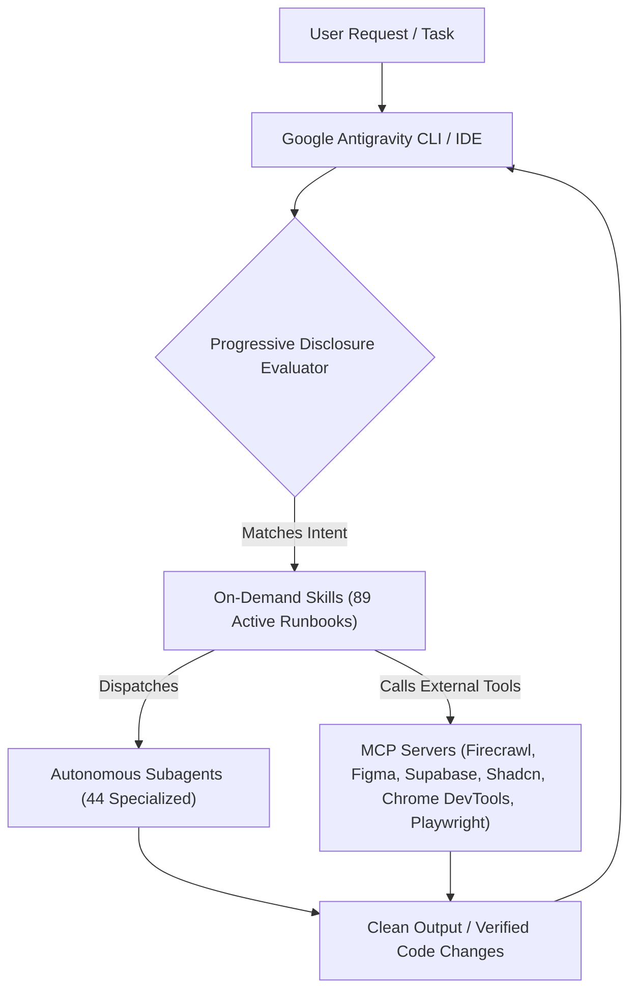

<div align="center">

<h1>⚡ Google Antigravity Skills & Plugins Hub</h1>

<p><em>The ultimate production-ready customization directory for Google Antigravity 2.0 & the Gemini Agent CLI.</em></p>

<p>
  <a href="https://antigravity.google.com"></a>
  <a href="./plugins"></a>
  <a href="./plugins"></a>
  <a href="./plugins"></a>
  <a href="./mcp_config.example.json"></a>
  <a href="./scripts/test_plugins.py"></a>
  <a href="./LICENSE"></a>
</p>

<br/>

[**✨ Overview**](#-overview) • [**⚡ Quick Installation**](#-quick-installation) • [**🧩 Plugins Directory**](#-complete-plugins--skills-directory) • [**🔌 MCP Servers Suite**](#-mcp-servers-suite) • [**📐 Architecture**](#-antigravity-architecture) • [**🧪 Validation**](#-automated-validation)

</div>

---

## ✨ Overview

**`Antigravity-Skills`** is a curated, production-tested suite of **62 official-grade plugins** built to extend Google Antigravity.

It elevates your AI pair-programming assistant into a specialized team of software architects, database engineers, security auditors, automated QA engineers, and design leads.

### 💎 Highlights at a Glance

| Capability | Details |
| :--- | :--- |
| **🧩 62 Verified Plugins** | Modular bundles encompassing skills, rules, subagents, and MCP configurations. |
| **🎯 89 On-Demand Skills** | Progressive disclosure runbooks loaded strictly when triggered to conserve context window tokens. |
| **🤖 44 Autonomous Subagents** | Role-specialized agents (`code-reviewer`, `database-architect`, `devops-engineer`, `performance-auditor`, `ui-component-engineer`, `web-designer`, `supabase-architect`) running on Flash & Pro models. |
| **🔌 21 MCP Tool Servers** | Direct integrations with Firecrawl, Figma, Supabase, Shadcn UI, Chrome DevTools, SQLite, PostgreSQL, Docker, Playwright, Firebase, Context7, Serena, GitHub, Linear, and Terraform. |
| **🚀 Universal Installer** | Included CLI installer (`scripts/install.py`) supporting both global (`~/.gemini/config/plugins/`) and project-scoped (`.agents/plugins/`) setups. |
| **✅ 100% Automated Testing** | Automated schema, YAML frontmatter, path resolution, and syntax validation suite passing at 100%. |

---

## ⚡ Quick Installation

### 1. Global Installation (Recommended)

Install all 62 plugins globally across your machine so they are immediately active in **every** project:

```bash
# Clone the repository
git clone https://github.com/Ganeshbeldar015/Antigravity-Skills.git
cd Antigravity-Skills

# Install and register all 62 plugins globally
python scripts/install.py --all --scope global
```

### 2. Project-Scoped Installation (Team Sharing)

To install specific plugins inside a single project (saved into `.agents/plugins/` to check into Git for your team):

```bash
# Inside your project repository directory:
python <path-to-Antigravity-Skills>/scripts/install.py database-tools --scope project
```

### 3. Interactive CLI Commands

```bash
# List all 62 plugins with versions and summaries
python scripts/install.py --list

# Inspect all plugins providing MCP servers and their transport types
python scripts/install.py --mcp

# Run the full validation test suite
python scripts/test_plugins.py
```

---

## 🔌 MCP Servers Suite

This repository includes a turnkey unified configuration file: [`mcp_config.example.json`](./mcp_config.example.json).

Connect these leading Model Context Protocol tools directly to your Antigravity environment:

| Tool Server | Provider | Transport | Key Capabilities |
| :--- | :--- | :---: | :--- |
| **`chrome-devtools`** | Chrome DevTools MCP | `Stdio` | Real-time browser debugging, console logs, network error tracking, and Core Web Vitals analysis. |
| **`sqlite`** | Model Context Protocol | `Stdio` | Direct SQL inspection, schema analysis, and query execution on SQLite databases. |
| **`postgres`** | Model Context Protocol | `Stdio` | Production PostgreSQL database introspection, query tuning, and index analysis. |
| **`docker`** | Docker CLI MCP | `Stdio (Docker)` | Container lifecycle management, image inspecting, logs tailing, and compose stack control. |
| **`playwright`** | Microsoft Playwright | `Stdio` | Full headless browser automation, element clicking, form submission, and live screenshot capture. |
| **`context7`** | Upstash Context7 | `HTTP` | Live, real-time documentation retrieval for modern libraries and SDKs. |
| **`firebase`** | Google Firebase | `Stdio` | Manage Firestore databases, Cloud Functions, and Firebase Auth rules. |
| **`github`** | GitHub Copilot | `HTTP` | Automated issue creation, pull request generation, and repository querying. |
| **`linear`** | Linear App | `HTTP` | Issue management, sprint cycle planning, and project roadmap updates. |
| **`serena`** | Serena Codebase | `Stdio` | Semantic symbol graphing, reference mapping, and codebase exploration. |
| **`terraform`** | HashiCorp Terraform | `Stdio (Docker)` | Infrastructure-as-code linting, validation, and cloud state planning. |
| **`shadcn`** | Shadcn UI | `Stdio` | Direct CLI scaffolding of modern Tailwind CSS & React UI components. |
| **`firecrawl`** | Firecrawl | `Stdio` | LLM web scraping, recursive domain crawling, clean markdown extraction, and site mapping. |
| **`figma`** | Figma | `HTTP` | Inspect Figma design files, auto-layouts, tokens, and convert design nodes to clean React/Tailwind code. |
| **`supabase`** | Supabase | `Stdio` | Cloud Postgres management, schema migrations, Row-Level Security (RLS), and Edge Functions. |
| **`canva`** | Canva | `HTTP / Bridge` | Fetch design templates, visual assets, brand kits, and graphics generation. |
| **`21st`** | 21st.dev | `HTTP / Bridge` | Curated Tailwind/React UI blocks, themes, and design component inspiration. |

### Enable Unified MCP Globally

```powershell
# On Windows (PowerShell):
Copy-Item mcp_config.example.json "$HOME\.gemini\config\mcp_config.json"

# On macOS / Linux:
cp mcp_config.example.json ~/.gemini/config/mcp_config.json
```

---

## 🧩 Complete Plugins & Skills Directory

<details open>
<summary><h3>🛠️ Development, Architecture & Databases (14 Plugins)</h3></summary>

> *End-to-end software engineering acceleration: multi-stage feature planning, code simplification, database schema engineering (SQLite/PostgreSQL), Docker containerization, and Git automation.*

| Plugin | Version | Contained Skills | Subagents | MCP | Description |
| :--- | :---: | :--- | :--- | :---: | :--- |
| **[`feature-dev`](./plugins/feature-dev)** | `1.0.0` | • <code>feature-dev</code> | • <code>code-architect</code><br/>• <code>code-explorer</code><br/>• <code>code-reviewer</code> | — | Comprehensive feature development workflow with specialized agents for codebase exploration, ar... |
| **[`database-tools`](./plugins/database-tools)** | `1.0.0` | • <code>schema-architect</code><br/>• <code>query-optimizer</code> | • <code>database-architect</code> | ⚡ <b>Yes</b> | Production database engineering toolkit: schema design, SQL query optimization, migration autom... |
| **[`docker-devops`](./plugins/docker-devops)** | `1.0.0` | • <code>dockerfile-optimizer</code><br/>• <code>compose-architect</code> | • <code>devops-engineer</code> | ⚡ <b>Yes</b> | Docker containerization and Compose orchestration toolkit: multi-stage build optimization, secu... |
| **[`code-simplifier`](./plugins/code-simplifier)** | `1.0.0` | — | • <code>code-simplifier</code> | — | Agent that simplifies and refines code for clarity, consistency, and maintainability while pres... |
| **[`commit-commands`](./plugins/commit-commands)** | `1.0.0` | • <code>clean-gone</code><br/>• <code>commit</code><br/>• <code>commit-push-pr</code> | — | — | Streamline your git workflow with simple commands for committing, pushing, and creating pull re... |
| **[`antigravity-plugin-dev`](./plugins/antigravity-plugin-dev)** | `1.0.0` | • <code>agent-development</code><br/>• <code>command-development</code><br/>• <code>create-plugin</code><br/>• <code>hook-development</code><br/>• <code>mcp-integration</code><br/>• <code>plugin-settings</code><br/>• <code>plugin-structure</code><br/>• <code>skill-development</code> | • <code>agent-creator</code><br/>• <code>plugin-validator</code><br/>• <code>skill-reviewer</code> | — | Plugin development toolkit with skills for creating agents, commands, hooks, MCP integrations, ... |
| **[`skill-creator`](./plugins/skill-creator)** | `1.0.0` | • <code>skill-creator</code> | — | — | Create new skills, improve existing skills, and measure skill performance. Use when users want ... |
| **[`agent-sdk-dev`](./plugins/agent-sdk-dev)** | `1.0.0` | • <code>new-sdk-app</code> | • <code>agent-sdk-verifier-py</code><br/>• <code>agent-sdk-verifier-ts</code> | — | Antigravity Agent SDK Development Plugin |
| **[`antigravity-setup`](./plugins/antigravity-setup)** | `1.0.0` | • <code>claude-automation-recommender</code> | — | — | Analyze codebases and recommend tailored Google Antigravity automations such as hooks, skills, ... |
| **[`antigravity-rules-management`](./plugins/antigravity-rules-management)** | `1.0.0` | • <code>claude-md-improver</code><br/>• <code>revise-claude-md</code> | — | — | Tools to maintain and improve AGENTS.md files - audit quality, capture session learnings, and k... |
| **[`hookify`](./plugins/hookify)** | `1.0.0` | • <code>configure</code><br/>• <code>help</code><br/>• <code>hookify</code><br/>• <code>list</code><br/>• <code>writing-rules</code> | • <code>conversation-analyzer</code> | — | Easily create hooks to prevent unwanted behaviors by analyzing conversation patterns |
| **[`cwc-makers`](./plugins/cwc-makers)** | `1.0.0` | • <code>cardputer-buddy</code><br/>• <code>m5-onboard</code><br/>• <code>maker-setup</code> | — | — | Seamless onboarding for the Code-with-Antigravity Makers Cardputer: one /maker-setup command cl... |
| **[`code-modernization`](./plugins/code-modernization)** | `1.0.0` | • <code>modernize</code><br/>• <code>modernize-assess</code><br/>• <code>modernize-brief</code><br/>• <code>modernize-extract-rules</code><br/>• <code>modernize-harden</code><br/>• <code>modernize-map</code><br/>• <code>modernize-preflight</code><br/>• <code>modernize-reimagine</code><br/>• <code>modernize-review</code><br/>• <code>modernize-status</code><br/>• <code>modernize-transform</code><br/>• <code>modernize-uplift</code><br/>• <code>modernize-verify</code> | • <code>architecture-critic</code><br/>• <code>business-rules-extractor</code><br/>• <code>legacy-analyst</code><br/>• <code>scaffolder</code><br/>• <code>security-auditor</code><br/>• <code>test-engineer</code><br/>• <code>uplift-migrator</code><br/>• <code>version-delta-analyst</code> | — | Guided modernization for any legacy codebase: start with /modernize, get an assessment, an inte... |
| **[`example-plugin`](./plugins/example-plugin)** | `1.0.0` | • <code>example-command</code><br/>• <code>example-skill</code> | — | ⚡ <b>Yes</b> | A comprehensive example plugin demonstrating all Google Antigravity extension options including... |

</details>

<details open>
<summary><h3>🛡️ Code Review & Security Auditing (4 Plugins)</h3></summary>

> *Deep static application security testing (SAST), automated OWASP vulnerability scanners, and specialized multi-agent PR review panels with confidence grading.*

| Plugin | Version | Contained Skills | Subagents | MCP | Description |
| :--- | :---: | :--- | :--- | :---: | :--- |
| **[`code-review`](./plugins/code-review)** | `1.0.0` | • <code>code-review</code> | — | — | Automated code review for pull requests using multiple specialized agents with confidence-based... |
| **[`pr-review-toolkit`](./plugins/pr-review-toolkit)** | `1.0.0` | • <code>review-pr</code> | • <code>code-reviewer</code><br/>• <code>code-simplifier</code><br/>• <code>comment-analyzer</code><br/>• <code>pr-test-analyzer</code><br/>• <code>silent-failure-hunter</code><br/>• <code>type-design-analyzer</code> | — | Comprehensive PR review agents specializing in comments, tests, error handling, type design, co... |
| **[`antigravity-security`](./plugins/antigravity-security)** | `0.12.0` | • <code>claude-security</code> | • <code>claude-security</code><br/>• <code>explore</code><br/>• <code>patch-generator</code><br/>• <code>patch-verifier</code><br/>• <code>scan-inventory</code><br/>• <code>scan-loader</code><br/>• <code>scan-redactor</code><br/>• <code>scan-researcher</code><br/>• <code>scan-verifier</code> | — | Deep vulnerability scanning of your own code, run entirely inside your Google Antigravity sessi... |
| **[`security-guidance`](./plugins/security-guidance)** | `2.0.14` | — | — | — | Security review for Antigravity-generated code. Pattern-based warnings on edits, LLM-powered di... |

</details>

<details open>
<summary><h3>⚡ Language Server Protocol (LSP) Intelligence (12 Plugins)</h3></summary>

> *Real-time AST parsing, compile-time type diagnostics, and semantic definition tracking across 12 mainstream programming languages.*

| Plugin | Version | Contained Skills | Subagents | MCP | Description |
| :--- | :---: | :--- | :--- | :---: | :--- |
| **[`typescript-lsp`](./plugins/typescript-lsp)** | `1.0.0` | • <code>typescript-lsp</code> | — | — | TypeScript and JavaScript language server for Node.js, React, and web projects in Google Antigr... |
| **[`pyright-lsp`](./plugins/pyright-lsp)** | `1.0.0` | • <code>pyright-lsp</code> | — | — | Pyright static type checker and language server for Python projects in Google Antigravity. |
| **[`clangd-lsp`](./plugins/clangd-lsp)** | `1.0.0` | • <code>clangd-lsp</code> | — | — | C/C++ language server (clangd) integration for Google Antigravity, providing AST diagnostics, c... |
| **[`rust-analyzer-lsp`](./plugins/rust-analyzer-lsp)** | `1.0.0` | • <code>rust-analyzer-lsp</code> | — | — | rust-analyzer language server for Rust projects in Google Antigravity. |
| **[`gopls-lsp`](./plugins/gopls-lsp)** | `1.0.0` | • <code>gopls-lsp</code> | — | — | Go language server (gopls) integration for Google Antigravity, providing analysis, package navi... |
| **[`jdtls-lsp`](./plugins/jdtls-lsp)** | `1.0.0` | • <code>jdtls-lsp</code> | — | — | Eclipse JDT.LS language server for Java projects in Google Antigravity. |
| **[`csharp-lsp`](./plugins/csharp-lsp)** | `1.0.0` | • <code>csharp-lsp</code> | — | — | C# language server integration for Google Antigravity, providing semantic analysis, completions... |
| **[`kotlin-lsp`](./plugins/kotlin-lsp)** | `1.0.0` | • <code>kotlin-lsp</code> | — | — | Kotlin language server for Kotlin and Android projects in Google Antigravity. |
| **[`lua-lsp`](./plugins/lua-lsp)** | `1.0.0` | • <code>lua-lsp</code> | — | — | Lua language server for Lua scripting, Game dev, and Neovim development in Google Antigravity. |
| **[`php-lsp`](./plugins/php-lsp)** | `1.0.0` | • <code>php-lsp</code> | — | — | PHP language server integration for PHP and Laravel projects in Google Antigravity. |
| **[`ruby-lsp`](./plugins/ruby-lsp)** | `1.0.0` | • <code>ruby-lsp</code> | — | — | Ruby LSP language server for Ruby and Rails projects in Google Antigravity. |
| **[`swift-lsp`](./plugins/swift-lsp)** | `1.0.0` | • <code>swift-lsp</code> | — | — | SourceKit-LSP language server for Swift and Apple platform development in Google Antigravity. |

</details>

<details open>
<summary><h3>🌐 MCP Servers, Browser DevTools & Cloud (21 Plugins)</h3></summary>

> *Model Context Protocol (MCP) bridges connecting Antigravity directly to Chrome DevTools, Playwright headless browser automation, cloud databases, issue trackers, and external developer platforms.*

| Plugin | Version | Contained Skills | Subagents | MCP | Description |
| :--- | :---: | :--- | :--- | :---: | :--- |
| **[`firecrawl`](./plugins/firecrawl)** | `1.0.0` | • <code>firecrawl-scraper</code> | • <code>web-crawler</code> | ⚡ <b>Yes</b> | Official Firecrawl web scraper, crawler, and clean markdown extractor MCP server for AI agents. |
| **[`figma`](./plugins/figma)** | `1.0.0` | • <code>figma-design-to-code</code> | • <code>figma-inspector</code> | ⚡ <b>Yes</b> | Official Figma MCP integration. Inspect design tokens, auto-layouts, and convert design nodes to React/Tailwind. |
| **[`supabase`](./plugins/supabase)** | `1.0.0` | • <code>supabase-expert</code> | • <code>supabase-architect</code> | ⚡ <b>Yes</b> | Official Supabase MCP integration. Manage cloud Postgres, schema migrations, RLS policies, and Edge Functions. |
| **[`shadcn`](./plugins/shadcn)** | `1.0.0` | • <code>shadcn-ui</code> | • <code>ui-component-engineer</code> | ⚡ <b>Yes</b> | Scaffold and integrate modern React UI components, blocks, and design systems from Shadcn UI & React Bits registries. |
| **[`chrome-devtools`](./plugins/chrome-devtools)** | `1.0.0` | • <code>browser-debugger</code><br/>• <code>web-vitals-profiler</code> | • <code>performance-auditor</code> | ⚡ <b>Yes</b> | Real-time browser debugging and web performance profiling using Chrome DevTools MCP: inspect co... |
| **[`playwright`](./plugins/playwright)** | `1.0.0` | — | — | ⚡ <b>Yes</b> | Browser automation and end-to-end testing MCP server by Microsoft. Enables Antigravity to inter... |
| **[`context7`](./plugins/context7)** | `1.0.0` | — | — | ⚡ <b>Yes</b> | Upstash Context7 MCP server for up-to-date documentation lookup. Connects to Context7's hosted ... |
| **[`firebase`](./plugins/firebase)** | `1.0.0` | — | — | ⚡ <b>Yes</b> | Google Firebase MCP integration. Manage Firestore databases, authentication, cloud functions, h... |
| **[`github`](./plugins/github)** | `1.0.0` | — | — | ⚡ <b>Yes</b> | Official GitHub MCP server for repository management. Create issues, manage pull requests, revi... |
| **[`gitlab`](./plugins/gitlab)** | `1.0.0` | — | — | ⚡ <b>Yes</b> | GitLab DevOps platform integration. Manage repositories, merge requests, CI/CD pipelines, issue... |
| **[`linear`](./plugins/linear)** | `1.0.0` | — | — | ⚡ <b>Yes</b> | Linear issue tracking integration. Create issues, manage projects, update statuses, search acro... |
| **[`serena`](./plugins/serena)** | `1.0.0` | — | — | ⚡ <b>Yes</b> | Semantic code analysis MCP server providing intelligent code understanding, refactoring suggest... |
| **[`terraform`](./plugins/terraform)** | `1.0.0` | — | — | ⚡ <b>Yes</b> | The Terraform MCP Server provides seamless integration with Terraform ecosystem, enabling advan... |
| **[`asana`](./plugins/asana)** | `1.0.0` | • <code>asana-setup</code> | — | — | Asana project management integration. Connects Google Antigravity to Asana's V2 MCP server (htt... |
| **[`laravel-boost`](./plugins/laravel-boost)** | `1.0.0` | — | — | ⚡ <b>Yes</b> | Laravel development toolkit MCP server. Provides intelligent assistance for Laravel application... |
| **[`mcp-server-dev`](./plugins/mcp-server-dev)** | `1.0.0` | • <code>build-mcp-app</code><br/>• <code>build-mcp-server</code><br/>• <code>build-mcpb</code> | — | — | Skills for designing and building MCP servers that work seamlessly with Antigravity — guides yo... |
| **[`mcp-tunnels`](./plugins/mcp-tunnels)** | `1.0.0` | • <code>create-docker-mcp-tunnel</code> | — | — | Connect Antigravity to a private MCP server through an Google Antigravity Ecosystem MCP tunnel.... |
| **[`discord`](./plugins/discord)** | `0.0.4` | • <code>access</code><br/>• <code>configure</code> | — | ⚡ <b>Yes</b> | Discord channel for Google Antigravity — messaging bridge with built-in access control. Manage ... |
| **[`telegram`](./plugins/telegram)** | `0.0.7` | • <code>access</code><br/>• <code>configure</code> | — | ⚡ <b>Yes</b> | Telegram channel for Google Antigravity — messaging bridge with built-in access control. Manage... |
| **[`imessage`](./plugins/imessage)** | `0.2.0` | • <code>access</code><br/>• <code>configure</code> | — | ⚡ <b>Yes</b> | iMessage channel for Google Antigravity — reads chat.db directly, sends via AppleScript. Built-... |
| **[`fakechat`](./plugins/fakechat)** | `0.0.1` | — | — | ⚡ <b>Yes</b> | Localhost iMessage-style web chat for Google Antigravity — test surface with file upload and ed... |

</details>

<details open>
<summary><h3>🎨 Design, Mathematics & Reasoning (11 Plugins)</h3></summary>

> *Tailored frontend UI/UX design engines, live interactive HTML playgrounds, mathematical Olympiad problem-solvers, and transparent telemetry reporters.*

| Plugin | Version | Contained Skills | Subagents | MCP | Description |
| :--- | :---: | :--- | :--- | :---: | :--- |
| **[`web-design`](./plugins/web-design)** | `1.0.0` | • <code>web-design</code><br/>• <code>ux-ui</code> | • <code>web-designer</code> | — | Web graphic design, UI/UX systems, layouts, typography, and visual styling (Bauhaus, Pop Art, Retro, Futuristic). |
| **[`frontend-design`](./plugins/frontend-design)** | `1.0.0` | • <code>frontend-design</code> | — | — | Frontend design skill for UI/UX implementation |
| **[`project-artifact`](./plugins/project-artifact)** | `1.0.0` | • <code>project-artifact</code> | — | — | Generate and publish a project status artifact — an opinionated, tabbed status page (overview &... |
| **[`playground`](./plugins/playground)** | `1.0.0` | • <code>playground</code> | — | — | Creates interactive HTML playgrounds — self-contained single-file explorers with visual control... |
| **[`math-olympiad`](./plugins/math-olympiad)** | `1.0.0` | • <code>math-olympiad</code> | — | — | Solve competition math (IMO, Putnam, USAMO) with adversarial verification that catches what sel... |
| **[`math-proof`](./plugins/math-proof)** | `1.0.0` | • <code>siege</code><br/>• <code>solo</code> | • <code>math-proof-judge</code><br/>• <code>math-proof-worker-deep</code><br/>• <code>math-proof-worker</code> | — | Two skills for hard mathematics problems, each ending in a self-contained proof.md: /math-proof... |
| **[`session-report`](./plugins/session-report)** | `1.0.0` | • <code>session-report</code> | — | — | Session Report integration and capabilities for Google Antigravity. |
| **[`receipts`](./plugins/receipts)** | `1.0.0` | • <code>receipts</code> | — | — | Receipts integration and capabilities for Google Antigravity. |
| **[`ralph-loop`](./plugins/ralph-loop)** | `1.0.0` | • <code>cancel-ralph</code><br/>• <code>help</code><br/>• <code>ralph-loop</code> | — | — | Continuous self-referential AI loops for interactive iterative development, implementing the Ra... |
| **[`explanatory-output-style`](./plugins/explanatory-output-style)** | `1.0.0` | — | — | — | Adds educational insights about implementation choices and codebase patterns (mimics the deprec... |
| **[`learning-output-style`](./plugins/learning-output-style)** | `1.0.0` | — | — | — | Interactive learning mode that requests meaningful code contributions at decision points (mimic... |

</details>

---

## 📐 Antigravity Architecture

Antigravity plugins leverage **Progressive Disclosure** to deliver elite multi-agent capabilities without overwhelming context budgets:



### Folder Hierarchy Specification

```text
plugins/<plugin_name>/
├── plugin.json         # Manifest declaration (name, version, description)
├── README.md           # Documentation and sample prompts
├── mcp_config.json     # Optional: Model Context Protocol configurations
├── hooks.json          # Optional: PreToolUse and PostToolUse lifecycle hooks
├── rules/
│   └── AGENTS.md       # Behavioral rules active whenever plugin is loaded
├── skills/
│   └── <skill_name>/
│       └── SKILL.md    # Progressive disclosure runbook with YAML frontmatter
└── agents/
    └── <agent_name>.md # Specialized autonomous subagent definition
```

---

## 🧪 Automated Validation

Every single plugin in this repository is strictly validated by our automated CI test suite:

```bash
python scripts/test_plugins.py
```

### Test Checks Included:

- [x] **Schema Validation**: Validates all `plugin.json` and `marketplace.json` manifests against Antigravity specifications.
- [x] **YAML Frontmatter Integrity**: Confirms every `SKILL.md` defines required `name` and `description` triggers.
- [x] **Agent Definitions**: Checks all 44 subagent `.md` files for supported model parameters (`inherit`, `flash`, `pro`).
- [x] **MCP Transports**: Validates JSON syntax and command/args structures across all 21 `mcp_config.json` files.
- [x] **100% Passed**: Zero warnings, zero dropped plugins.

---

## 🤝 Contributing

Contributions and new Antigravity plugins are warmly welcome!

1. Fork this repository: [`https://github.com/Ganeshbeldar015/Antigravity-Skills`](https://github.com/Ganeshbeldar015/Antigravity-Skills).
2. Create your feature branch (`git checkout -b feature/awesome-plugin`).
3. Add your plugin under `plugins/<plugin-name>/` with `plugin.json`, `README.md`, and `skills/`.
4. Run `python scripts/test_plugins.py` to ensure validation passes.
5. Commit your changes and open a Pull Request.

---

## 📄 License

Distributed under the [MIT License](./LICENSE). Copyright (c) 2026 Ganesh Bhaktaraj Beldar (Ganeshbeldar015).
