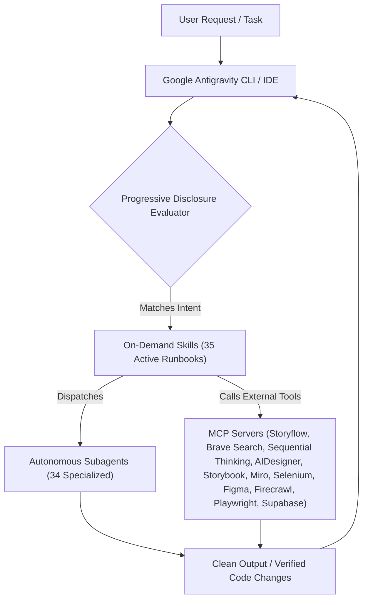

<div align="center">

<h1>⚡ Google Antigravity Skills & Plugins Hub</h1>

<p><em>The ultimate production-ready customization directory for Google Antigravity 2.0 & the Gemini Agent CLI.</em></p>

<p>
  <a href="https://antigravity.google.com"></a>
  <a href="./plugins"></a>
  <a href="./plugins"></a>
  <a href="./plugins"></a>
  <a href="./mcp_config.example.json"></a>
  <a href="./scripts/test_plugins.py"></a>
  <a href="./LICENSE"></a>
</p>

<br/>

[**✨ Overview**](#-overview) • [**⚡ Quick Installation**](#-quick-installation) • [**🧩 Plugins Directory**](#-complete-plugins--skills-directory) • [**🔌 MCP Servers Suite**](#-mcp-servers-suite) • [**📐 Architecture**](#-antigravity-architecture) • [**🧪 Validation**](#-automated-validation)

</div>

---

## ✨ Overview

**`Antigravity-Skills`** is a curated, production-tested suite of **37 high-performance plugins** built to extend Google Antigravity.

Streamlined for modern software engineering, web development, and cloud architecture, it eliminates bloat, hardware-locked dependencies, and dummy templates while giving your AI pair-programming assistant an elite team of architects, database engineers, security auditors, automated QA testers, and UI/UX design leads.

### 💎 Highlights at a Glance

| Capability | Details |
| :--- | :--- |
| **🧩 37 Streamlined Plugins** | High-utility modular bundles encompassing skills, rules, subagents, and MCP configurations with zero bloat. |
| **🎯 35 On-Demand Skills** | Progressive disclosure runbooks loaded strictly when triggered to conserve context window tokens. |
| **🤖 34 Autonomous Subagents** | Role-specialized agents (`deep-reasoner`, `web-researcher`, `storyflow-facilitator`, `aidesigner-specialist`, `code-reviewer`, `database-architect`, `devops-engineer`, `performance-auditor`, `ui-component-engineer`, `web-designer`, `supabase-architect`, `storybook-specialist`, `cross-browser-tester`) running on Flash & Pro models. |
| **🔌 23 MCP Tool Servers** | Turnkey integrations with Storyflow, Sequential Thinking, Brave Search, AIDesigner, Storybook, Miro, Selenium, Firecrawl, Figma, Supabase, Shadcn UI, Chrome DevTools, SQLite, PostgreSQL, Docker, Playwright, Firebase, Context7, Serena, GitHub, 21st, Canva, and Google Stitch. |
| **🚀 Universal Installer** | Included CLI installer (`scripts/install.py`) supporting both global (`~/.gemini/config/plugins/`) and project-scoped (`.agents/plugins/`) setups. |
| **✅ 100% Automated Testing** | Automated schema, YAML frontmatter, path resolution, and syntax validation suite passing at 100%. |

---

## ⚡ Quick Installation

### 1. Global Installation (Recommended)

Install all 37 streamlined plugins globally across your machine so they are immediately active in **every** project:

```bash
# Clone the repository
git clone https://github.com/Ganeshbeldar015/Antigravity-Skills.git
cd Antigravity-Skills

# Install and register all 37 plugins globally
python scripts/install.py --all --scope global
```

### 2. Project-Scoped Installation (Team Sharing)

To install specific plugins inside a single project (saved into `.agents/plugins/` to check into Git for your team):

```bash
# Inside your project repository directory:
python <path-to-Antigravity-Skills>/scripts/install.py database-tools --scope project
```

### 3. Interactive CLI Commands

```bash
# List all 37 plugins with versions and summaries
python scripts/install.py --list

# Inspect all 19 plugins providing MCP servers and their transport types
python scripts/install.py --mcp

# Run the full validation test suite (100% passing across 37 plugins)
python scripts/test_plugins.py
```

---

## 🔌 MCP Servers Suite

This repository includes a turnkey unified configuration file: [`mcp_config.example.json`](./mcp_config.example.json).

Connect these 23 leading Model Context Protocol tools directly to your Antigravity environment:

| Tool Server | Provider | Transport | Key Capabilities |
| :--- | :--- | :---: | :--- |
| **`aidesigner`** | AIDesigner AI | `HTTP (OAuth)` | Generative UI artifacts, clone/enhance visual workflows, screenshot QA, and repository adoption. |
| **`storyflow`** | Storyflow | `HTTP (OAuth)` | Infinite canvas workspace, visual agile Kanban boards, mind maps, and user story mapping. |
| **`sequential-thinking`** | Model Context Protocol | `Stdio` | Multi-step chain-of-thought dynamic reasoning, hypothesis testing, branching, and backtracking. |
| **`brave-search`** | Brave Software | `Stdio` | Privacy-focused live web and local news searches against the independent Brave Index. |
| **`chrome-devtools`** | Chrome DevTools MCP | `Stdio` | Real-time browser debugging, console logs, network error tracking, and Core Web Vitals analysis. |
| **`sqlite`** | Model Context Protocol | `Stdio` | Direct SQL inspection, schema analysis, and query execution on SQLite databases. |
| **`postgres`** | Model Context Protocol | `Stdio` | Production PostgreSQL database introspection, query tuning, and index analysis. |
| **`docker`** | Docker CLI MCP | `Stdio (Docker)` | Container lifecycle management, image inspecting, logs tailing, and compose stack control. |
| **`playwright`** | Microsoft Playwright | `Stdio` | Full headless browser automation, element clicking, form submission, and live screenshot capture. |
| **`context7`** | Upstash Context7 | `HTTP` | Live, real-time documentation retrieval for modern libraries and SDKs. |
| **`firebase`** | Google Firebase | `Stdio` | Manage Firestore databases, Cloud Functions, and Firebase Auth rules. |
| **`github`** | GitHub Copilot | `HTTP` | Automated issue creation, pull request generation, and repository querying. |
| **`serena`** | Serena Codebase | `Stdio` | Semantic symbol graphing, reference mapping, and codebase exploration. |
| **`shadcn`** | Shadcn UI | `Stdio` | Direct CLI scaffolding of modern Tailwind CSS & React UI components and blocks. |
| **`firecrawl`** | Firecrawl | `Stdio` | LLM web scraping, recursive domain crawling, clean markdown extraction, and site mapping. |
| **`figma`** | Figma | `HTTP` | Inspect Figma design files, auto-layouts, tokens, and convert design nodes to clean React/Tailwind code. |
| **`supabase`** | Supabase | `Stdio` | Cloud Postgres management, schema migrations, Row-Level Security (RLS), and Edge Functions. |
| **`canva`** | Canva | `HTTP / Bridge` | Fetch design templates, visual assets, brand kits, and graphics generation. |
| **`21st`** | 21st.dev | `HTTP / Bridge` | Curated Tailwind/React UI blocks, themes, and design component inspiration. |
| **`StitchMCP`** | Google Stitch | `HTTP / Bridge` | Generative design systems, prompt-to-screen UI generation, and visual variants. |
| **`storybook`** | Storybook Design System | `Stdio` | Component discovery, props introspection, and design system reuse to prevent UI hallucination. |
| **`miro`** | Miro Whiteboard | `Stdio` | Digital whiteboard collaboration, sticky notes, diagram shapes, and workshop canvases. |
| **`selenium`** | Selenium WebDriver | `Stdio` | Automated cross-browser compatibility testing, DOM interaction, and accessibility checks. |

### 🔑 Environment Variables Reference

While many servers (like `sequential-thinking`, `playwright`, `sqlite`, `chrome-devtools`) work out of the box with zero credentials, cloud-connected MCP servers read optional environment variables:

| Environment Variable | Target MCP Server | How to Obtain / Tier |
| :--- | :--- | :--- |
| `BRAVE_API_KEY` | `brave-search` | Free tier available at [brave.com/search/api](https://brave.com/search/api/) |
| `FIRECRAWL_API_KEY` | `firecrawl` | Free starter tier at [firecrawl.dev](https://firecrawl.dev) (keyless mode also supported) |
| `FIGMA_ACCESS_TOKEN` | `figma` | Personal Access Token from Figma Account Settings |
| `SUPABASE_ACCESS_TOKEN` | `supabase` | Management API Token from [supabase.com/dashboard/account/tokens](https://supabase.com/dashboard/account/tokens) |
| `MIRO_OAUTH_TOKEN` | `miro` | Developer OAuth Token from Miro Developer Portal |
| `AIDESIGNER_MCP_ACCESS_TOKEN` | `aidesigner` | Account access token or OAuth browser login at [aidesigner.ai](https://aidesigner.ai) |

### Enable Unified MCP Globally

```powershell
# On Windows (PowerShell):
Copy-Item mcp_config.example.json "$HOME\.gemini\config\mcp_config.json"

# On macOS / Linux:
cp mcp_config.example.json ~/.gemini/config/mcp_config.json
```

---

## 🚀 Popular Agent Workflows

Antigravity automatically selects the right skill, subagent, and MCP tool based on your natural language prompt:

### 1. 🌐 Real-Time Web Research & Live Documentation
```text
"Search for the latest security vulnerabilities in Next.js 15 and extract key mitigations."
```
* **Engine**: Activates `brave-search` or `firecrawl` via the `web-researcher` subagent to query live web indexes beyond LLM knowledge cutoffs.

### 2. 🎨 AI Visual Design to Production Code
```text
"Generate a sleek dashboard hero section and convert it into accessible React & Tailwind components."
```
* **Engine**: Invokes `aidesigner` and `web-design` to establish aesthetic direction, then uses `shadcn` to scaffold verified accessible primitives.

### 3. 🧠 Deep Architectural Refactoring & Concurrency Debugging
```text
"Debug an intermittent race condition in our distributed cache using sequential thinking."
```
* **Engine**: Launches the `deep-reasoner` subagent with `sequential-thinking`, evaluating competing hypotheses step-by-step with dynamic branching.

### 4. 🛡️ Multi-Agent Pull Request Review
```text
"Review this pull request and check for silent failures, test coverage gaps, and type design quality."
```
* **Engine**: Dispatches `pr-review-toolkit` (`silent-failure-hunter`, `pr-test-analyzer`, `type-design-analyzer`, and `code-reviewer`) with confidence scoring.

### 5. 🗄️ Full-Stack Database & Backend Migrations
```text
"Design a high-scale user schema migration with Row-Level Security in Supabase and optimize slow query joins."
```
* **Engine**: Launches `database-tools` and `supabase` via the `database-architect` subagent to design idempotent migrations and generate composite indexes.

---

## 🧩 Complete Plugins & Skills Directory

<details open>
<summary><h3>🛠️ Development, Architecture & Databases (7 Plugins)</h3></summary>

> *End-to-end software engineering acceleration: multi-stage feature planning, code simplification, database schema engineering (SQLite/PostgreSQL), Docker containerization, and Git automation.*

| Plugin | Version | Contained Skills | Subagents | MCP | Description |
| :--- | :---: | :--- | :--- | :---: | :--- |
| **[`feature-dev`](./plugins/feature-dev)** | `1.0.0` | • <code>feature-dev</code> | • <code>code-architect</code><br/>• <code>code-explorer</code><br/>• <code>code-reviewer</code> | — | Comprehensive feature development workflow with specialized agents for codebase exploration, architecture, and code review. |
| **[`database-tools`](./plugins/database-tools)** | `1.0.0` | • <code>schema-architect</code><br/>• <code>query-optimizer</code> | • <code>database-architect</code> | ⚡ <b>Yes</b> | Production database engineering toolkit: schema design, SQL query optimization, migration automation, and index design. |
| **[`docker-devops`](./plugins/docker-devops)** | `1.0.0` | • <code>dockerfile-optimizer</code><br/>• <code>compose-architect</code> | • <code>devops-engineer</code> | ⚡ <b>Yes</b> | Docker containerization and Compose orchestration toolkit: multi-stage build optimization, security, and compose stacks. |
| **[`code-simplifier`](./plugins/code-simplifier)** | `1.0.0` | — | • <code>code-simplifier</code> | — | Agent that simplifies and refines code for clarity, consistency, and maintainability while preserving functionality. |
| **[`commit-commands`](./plugins/commit-commands)** | `1.0.0` | • <code>clean-gone</code><br/>• <code>commit</code><br/>• <code>commit-push-pr</code> | — | — | Streamline your git workflow with simple commands for committing, pushing, and creating pull requests. |
| **[`antigravity-setup`](./plugins/antigravity-setup)** | `1.0.0` | • <code>claude-automation-recommender</code> | — | — | Analyze codebases and recommend tailored Google Antigravity automations such as hooks, skills, subagents, and MCPs. |
| **[`antigravity-rules-management`](./plugins/antigravity-rules-management)** | `1.0.0` | • <code>claude-md-improver</code><br/>• <code>revise-claude-md</code> | — | — | Tools to maintain and improve AGENTS.md files: audit quality, capture session learnings, and optimize project memory. |

</details>

<details open>
<summary><h3>🛡️ Code Review & Security Auditing (4 Plugins)</h3></summary>

> *Deep static application security testing (SAST), automated OWASP vulnerability scanners, and specialized multi-agent PR review panels with confidence grading.*

| Plugin | Version | Contained Skills | Subagents | MCP | Description |
| :--- | :---: | :--- | :--- | :---: | :--- |
| **[`code-review`](./plugins/code-review)** | `1.0.0` | • <code>code-review</code> | — | — | Automated code review for pull requests using multiple specialized agents with confidence-based filtering. |
| **[`pr-review-toolkit`](./plugins/pr-review-toolkit)** | `1.0.0` | • <code>review-pr</code> | • <code>code-reviewer</code><br/>• <code>code-simplifier</code><br/>• <code>comment-analyzer</code><br/>• <code>pr-test-analyzer</code><br/>• <code>silent-failure-hunter</code><br/>• <code>type-design-analyzer</code> | — | Comprehensive PR review agents specializing in comments, tests, error handling, type design, and silent failures. |
| **[`antigravity-security`](./plugins/antigravity-security)** | `0.12.0` | • <code>claude-security</code> | • <code>claude-security</code><br/>• <code>explore</code><br/>• <code>patch-generator</code><br/>• <code>patch-verifier</code><br/>• <code>scan-inventory</code><br/>• <code>scan-loader</code><br/>• <code>scan-redactor</code><br/>• <code>scan-researcher</code><br/>• <code>scan-verifier</code> | — | Deep vulnerability scanning of your code, run entirely inside your Google Antigravity session. |
| **[`security-guidance`](./plugins/security-guidance)** | `2.0.14` | — | — | — | Security review for Antigravity-generated code. Pattern-based warnings on edits, LLM-powered diagnostics, and remediation. |

</details>

<details open>
<summary><h3>⚡ Core Language Server Protocol (LSP) Intelligence (2 Plugins)</h3></summary>

> *Real-time AST parsing, compile-time type diagnostics, and semantic definition tracking for the web and Python ecosystems.*

| Plugin | Version | Contained Skills | Subagents | MCP | Description |
| :--- | :---: | :--- | :--- | :---: | :--- |
| **[`typescript-lsp`](./plugins/typescript-lsp)** | `1.0.0` | • <code>typescript-lsp</code> | — | — | TypeScript and JavaScript language server for Node.js, React, and web projects in Google Antigravity. |
| **[`pyright-lsp`](./plugins/pyright-lsp)** | `1.0.0` | • <code>pyright-lsp</code> | — | — | Pyright static type checker and language server for Python projects in Google Antigravity. |

</details>

<details open>
<summary><h3>🌐 MCP Servers, Browser DevTools & Cloud (13 Plugins)</h3></summary>

> *Model Context Protocol (MCP) bridges connecting Antigravity directly to Chrome DevTools, Playwright headless browser automation, cloud databases, and external developer platforms.*

| Plugin | Version | Contained Skills | Subagents | MCP | Description |
| :--- | :---: | :--- | :--- | :---: | :--- |
| **[`brave-search`](./plugins/brave-search)** | `1.0.0` | • <code>brave-search</code> | • <code>web-researcher</code> | ⚡ <b>Yes</b> | Official Brave Search MCP: private, real-time web and local news searches against the independent Brave Index. |
| **[`selenium`](./plugins/selenium)** | `1.0.0` | • <code>selenium-automation</code> | • <code>cross-browser-tester</code> | ⚡ <b>Yes</b> | Selenium WebDriver cross-browser testing, element navigation, and automated accessibility checks. |
| **[`firecrawl`](./plugins/firecrawl)** | `1.0.0` | • <code>firecrawl-scraper</code> | • <code>web-crawler</code> | ⚡ <b>Yes</b> | Official Firecrawl web scraper, crawler, and clean markdown extractor MCP server for AI agents. |
| **[`figma`](./plugins/figma)** | `1.0.0` | • <code>figma-design-to-code</code> | • <code>figma-inspector</code> | ⚡ <b>Yes</b> | Official Figma MCP integration. Inspect design tokens, auto-layouts, and convert design nodes to React/Tailwind. |
| **[`supabase`](./plugins/supabase)** | `1.0.0` | • <code>supabase-expert</code> | • <code>supabase-architect</code> | ⚡ <b>Yes</b> | Official Supabase MCP integration. Manage cloud Postgres, schema migrations, RLS policies, and Edge Functions. |
| **[`shadcn`](./plugins/shadcn)** | `1.0.0` | • <code>shadcn-ui</code> | • <code>ui-component-engineer</code> | ⚡ <b>Yes</b> | Scaffold and integrate modern React UI components, blocks, and design systems from Shadcn UI & React Bits registries. |
| **[`chrome-devtools`](./plugins/chrome-devtools)** | `1.0.0` | • <code>browser-debugger</code><br/>• <code>web-vitals-profiler</code> | • <code>performance-auditor</code> | ⚡ <b>Yes</b> | Real-time browser debugging and web performance profiling using Chrome DevTools MCP. |
| **[`playwright`](./plugins/playwright)** | `1.0.0` | — | — | ⚡ <b>Yes</b> | Browser automation and end-to-end testing MCP server by Microsoft. |
| **[`context7`](./plugins/context7)** | `1.0.0` | — | — | ⚡ <b>Yes</b> | Upstash Context7 MCP server for live, version-accurate documentation lookup. |
| **[`firebase`](./plugins/firebase)** | `1.0.0` | — | — | ⚡ <b>Yes</b> | Google Firebase MCP integration. Manage Firestore databases, authentication, and cloud functions. |
| **[`github`](./plugins/github)** | `1.0.0` | — | — | ⚡ <b>Yes</b> | Official GitHub MCP server for repository management, pull requests, issues, and Actions. |
| **[`serena`](./plugins/serena)** | `1.0.0` | — | — | ⚡ <b>Yes</b> | Semantic code analysis MCP server providing intelligent code understanding and refactoring suggestions. |
| **[`mcp-tunnels`](./plugins/mcp-tunnels)** | `1.0.0` | • <code>create-docker-mcp-tunnel</code> | — | — | Connect Antigravity to a private MCP server through an Antigravity Ecosystem MCP tunnel. |

</details>

<details open>
<summary><h3>🎨 Design, UI/UX & Reasoning (11 Plugins)</h3></summary>

> *Tailored frontend UI/UX design engines, visual workspaces, generative artifact generation, live interactive HTML playgrounds, and sequential chain-of-thought reasoning.*

| Plugin | Version | Contained Skills | Subagents | MCP | Description |
| :--- | :---: | :--- | :--- | :---: | :--- |
| **[`storyflow`](./plugins/storyflow)** | `1.0.0` | • <code>storyflow-workspace</code> | • <code>storyflow-facilitator</code> | ⚡ <b>Yes</b> | Visual project management, infinite canvas ideation, Kanban boards, mind maps, and workflow automation via Storyflow MCP. |
| **[`sequential-thinking`](./plugins/sequential-thinking)** | `1.0.0` | • <code>sequential-thinking</code> | • <code>deep-reasoner</code> | ⚡ <b>Yes</b> | Multi-step chain-of-thought reasoning, hypothesis testing, branching, and adaptive problem-solving via Sequential Thinking MCP. |
| **[`aidesigner`](./plugins/aidesigner)** | `1.0.0` | • <code>aidesigner-frontend</code> | • <code>aidesigner-specialist</code> | ⚡ <b>Yes</b> | Establish visual direction, generate high-fidelity UI artifacts, and adopt designs into native frontend stacks via AIDesigner MCP. |
| **[`storybook`](./plugins/storybook)** | `1.0.0` | • <code>storybook-guide</code> | • <code>storybook-specialist</code> | ⚡ <b>Yes</b> | Storybook MCP server by Danny Williams: component discovery, story inspection, and design system reuse. |
| **[`miro`](./plugins/miro)** | `1.0.0` | • <code>miro-whiteboard</code> | • <code>whiteboard-facilitator</code> | ⚡ <b>Yes</b> | Miro whiteboard collaboration MCP: sticky notes, visual shapes, frames, and collaborative brainstorming. |
| **[`web-design`](./plugins/web-design)** | `1.0.0` | • <code>web-design</code><br/>• <code>ux-ui</code> | • <code>web-designer</code> | — | Web graphic design, UI/UX systems, layouts, typography, and visual styling (Bauhaus, Pop Art, Retro, Futuristic). |
| **[`frontend-design`](./plugins/frontend-design)** | `1.0.0` | • <code>frontend-design</code> | — | — | Frontend design skill for UI/UX implementation and distinctive interfaces. |
| **[`project-artifact`](./plugins/project-artifact)** | `1.0.0` | • <code>project-artifact</code> | — | — | Generate and publish a project status artifact: an opinionated, tabbed status page with PR tracking. |
| **[`playground`](./plugins/playground)** | `1.0.0` | • <code>playground</code> | — | — | Creates interactive HTML playgrounds: self-contained single-file explorers with visual controls. |
| **[`explanatory-output-style`](./plugins/explanatory-output-style)** | `1.0.0` | — | — | — | Adds educational insights about implementation choices and codebase patterns. |
| **[`learning-output-style`](./plugins/learning-output-style)** | `1.0.0` | — | — | — | Interactive learning mode that requests meaningful code contributions at decision points. |

</details>

---

## 📐 Antigravity Architecture

Antigravity plugins leverage **Progressive Disclosure** to deliver elite multi-agent capabilities without overwhelming context budgets:



### ⚡ Zero-Bloat Performance Engineering

This suite is engineered for minimal latency and maximum token efficiency:

* **0% Idle CPU & RAM (Lazy-Loaded MCPs)**: Tool servers like Playwright, Selenium, and Docker remain unspawned on disk until a prompt explicitly requires them.
* **Progressive Disclosure**: Full skill runbooks (`SKILL.md`) are never dumped into context up front. Only lightweight routing metadata is indexed, loading full instructions strictly on demand.
* **Optimized System Prompt**: Purged of hardware-locked devices, platform-incompatible bridges, and dummy templates—saving thousands of tokens per prompt turn for faster generation and laser-focused attention.

### Folder Hierarchy Specification

```text
plugins/<plugin_name>/
├── plugin.json         # Manifest declaration (name, version, description)
├── README.md           # Documentation and sample prompts
├── mcp_config.json     # Optional: Model Context Protocol configurations
├── hooks.json          # Optional: PreToolUse and PostToolUse lifecycle hooks
├── rules/
│   └── AGENTS.md       # Behavioral rules active whenever plugin is loaded
├── skills/
│   └── <skill_name>/
│       └── SKILL.md    # Progressive disclosure runbook with YAML frontmatter
└── agents/
    └── <agent_name>.md # Specialized autonomous subagent definition
```

---

## 🧪 Automated Validation

Every single plugin in this repository is strictly validated by our automated CI test suite:

```bash
python scripts/test_plugins.py
```

### Test Checks Included:

- [x] **Schema Validation**: Validates all `plugin.json` and `marketplace.json` manifests against Antigravity specifications.
- [x] **YAML Frontmatter Integrity**: Confirms every `SKILL.md` defines required `name` and `description` triggers.
- [x] **Agent Definitions**: Checks all 34 subagent `.md` files for supported model parameters (`inherit`, `flash`, `pro`).
- [x] **MCP Transports**: Validates JSON syntax and command/args structures across all 19 `mcp_config.json` files.
- [x] **100% Passed**: Zero warnings, zero dropped plugins.

---

## 🤝 Contributing

Contributions and new Antigravity plugins are warmly welcome!

1. Fork this repository: [`https://github.com/Ganeshbeldar015/Antigravity-Skills`](https://github.com/Ganeshbeldar015/Antigravity-Skills).
2. Create your feature branch (`git checkout -b feature/awesome-plugin`).
3. Add your plugin under `plugins/<plugin-name>/` with `plugin.json`, `README.md`, and `skills/`.
4. Run `python scripts/test_plugins.py` to ensure validation passes.
5. Commit your changes and open a Pull Request.

---

## 📄 License

Distributed under the [MIT License](./LICENSE). Copyright (c) 2026 Ganesh Bhaktaraj Beldar (Ganeshbeldar015).
