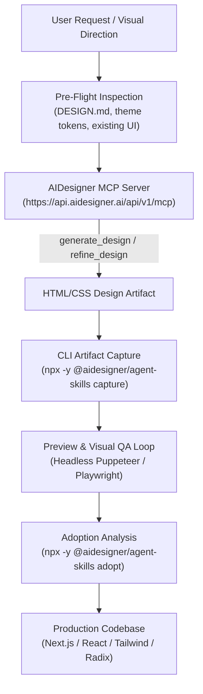

# AIDesigner Frontend Plugin for Google Antigravity

[](https://github.com/Ganeshbeldar015/Antigravity-Skills)
[](https://api.aidesigner.ai)
[](LICENSE)

A specialized frontend design plugin integrating **AIDesigner**'s generative design engine into Google Antigravity and Claude-compatible hosts. It empowers AI agents to establish bold visual directions, generate or refine standalone HTML/CSS artifacts, execute screenshot-based visual QA, and seamlessly adopt design artifacts into repository-native component frameworks (React, Next.js, Tailwind CSS, Vue, Svelte).

---

## Architecture & Features



- **Generative UI Generation**: Establish cohesive styling, rhythm, and layout aesthetics using prompt-driven design.
- **Multi-Mode Workflows**:
  - `prompt-only`: Fresh, creative UI tailored to your project requirements.
  - `clone`: Faithful, high-fidelity recreation of a reference URL.
  - `enhance`: Modernize an existing interface while preserving core information structure.
  - `inspire`: Extract visual patterns and design tokens from an existing site.
- **Automated Visual QA**: Integrated screenshot rendering and visual comparison to catch spacing, font, and alignment discrepancies.
- **Stack Adoption**: Translates raw HTML/CSS into your destination framework with zero-runtime utility classes and reusable components.

---

## MCP Server Configuration

The plugin connects directly to the AIDesigner remote MCP server endpoint:

```json
{
  "mcpServers": {
    "aidesigner": {
      "type": "http",
      "url": "https://api.aidesigner.ai/api/v1/mcp"
    }
  }
}
```

### Remote MCP Tools

| Tool | Purpose |
| :--- | :--- |
| `generate_design` | Generates a new HTML design artifact from a visual prompt and repo context |
| `refine_design` | Iterates on an existing run ID or artifact to adjust aesthetics or responsiveness |
| `get_credit_status` | Checks account credit limits and active tier |
| `whoami` | Returns authenticated user profile and account details |

---

## CLI Integration & Host Initialization

AIDesigner provides the `@aidesigner/agent-skills` CLI to initialize and bootstrap host environments:

```bash
npx -y @aidesigner/agent-skills init <host>
```

### Supported Hosts

| Host | Command | Output & Configuration |
| :--- | :--- | :--- |
| **`claude`** | `npx -y @aidesigner/agent-skills init claude` | Configures Claude Code project MCP (`.mcp.json`) & skill |
| **`cursor`** | `npx -y @aidesigner/agent-skills init cursor` | Configures `.cursor/mcp.json` & `.cursor/skills/` |
| **`codex`** | `npx -y @aidesigner/agent-skills init codex` | Configures `.codex/config.toml` |
| **`vscode`** | `npx -y @aidesigner/agent-skills init vscode` | Configures `.vscode/mcp.json` & GitHub Copilot skills |
| **`windsurf`** | `npx -y @aidesigner/agent-skills init windsurf --scope user` | Configures user-scope Windsurf MCP |
| **All Hosts** | `npx -y @aidesigner/agent-skills init --all --scope project` | Configures every supported host simultaneously |

### Key CLI Verbs

- `doctor`: Validate environment, token status, and host MCP connectivity (`npx -y @aidesigner/agent-skills doctor`).
- `capture`: Persist an MCP-generated HTML artifact locally into `.aidesigner/runs/<run-id>/`.
- `preview`: Render a responsive PNG snapshot of an artifact using headless browser automation.
- `adopt`: Generate an adoption brief to map elements into repo-native components and CSS tokens.

---

## Environment Variables

| Variable | Description |
| :--- | :--- |
| `AIDESIGNER_MCP_ACCESS_TOKEN` | Bearer token for authenticated MCP access |
| `AIDESIGNER_API_KEY` | Fallback API key for direct HTTP generation when MCP is unavailable |
| `AIDESIGNER_BASE_URL` | Base API URL (default: `https://api.aidesigner.ai`) |
| `AIDESIGNER_MCP_URL` | Custom MCP endpoint (default: `https://api.aidesigner.ai/api/v1/mcp`) |

---

## Skills & Agents Included

- **`aidesigner-frontend`** (`skills/aidesigner-frontend/SKILL.md`): End-to-end guidance for pre-flight scanning, visual prompt engineering, artifact generation, screenshot QA, and repository adoption.
- **`aidesigner-specialist`** (`agents/aidesigner-specialist.md`): Specialized autonomous subagent managing generative UI runs and production code integration.
