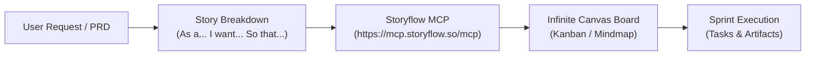

# Storyflow Workspace Skill

Use this skill when designing, organizing, or updating project roadmaps, Kanban boards, sprint backlogs, or user journey maps in **Storyflow** (`https://mcp.storyflow.so/mcp`).

## Core Capabilities

1. **Board Architecture & Ideation**:
   - Create infinite canvas boards for brainstorming, architectural mapping, and PRD breakdown.
   - Organize elements into thematic clusters: Epics, User Stories, Acceptance Criteria, and Tasks.

2. **Kanban & Sprint Management**:
   - Build agile workflows with standard stages: `Backlog`, `To Do`, `In Progress`, `Code Review`, `QA`, `Deployed`.
   - Update task states, assign owners, link pull requests, and track sprint deadlines.

3. **User Journey & Story Mapping**:
   - Break complex user experiences into sequential steps: Persona → Trigger → Goal → Friction → Resolution.
   - Link flow nodes with directional arrows to represent user decision trees.

4. **Mind Mapping & Architecture**:
   - Create structured central nodes with branch hierarchies representing service boundaries, APIs, or database schemas.

## MCP Authentication

Storyflow uses OAuth 2.0 PKCE over Streamable HTTP:
- Endpoint: `https://mcp.storyflow.so/mcp`
- Discovery: `https://mcp.storyflow.so/.well-known/oauth-authorization-server`
- Auth Flow: When prompted, authenticate in your browser to approve AI access to your Storyflow workspaces.

## Workflow Example

